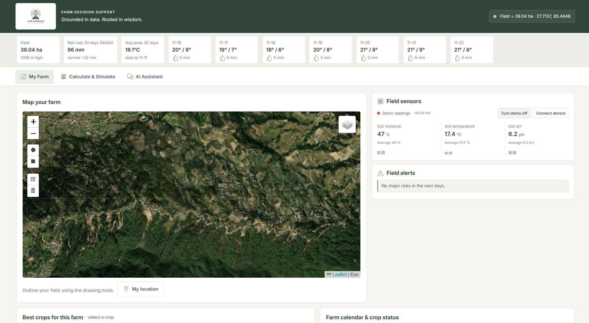
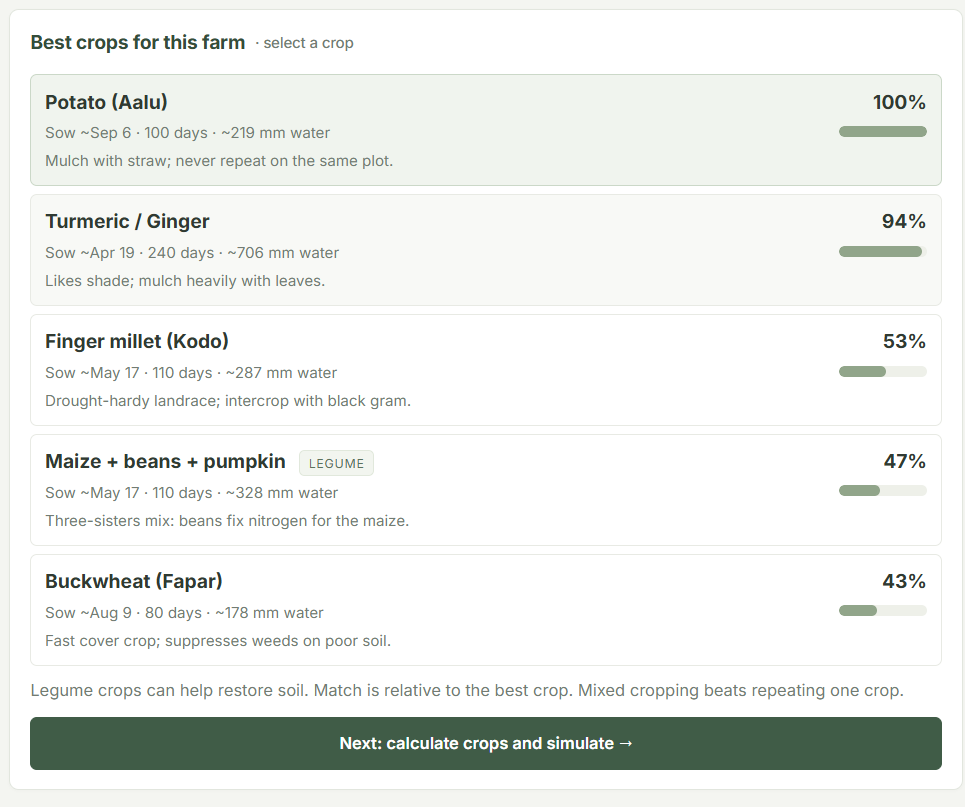
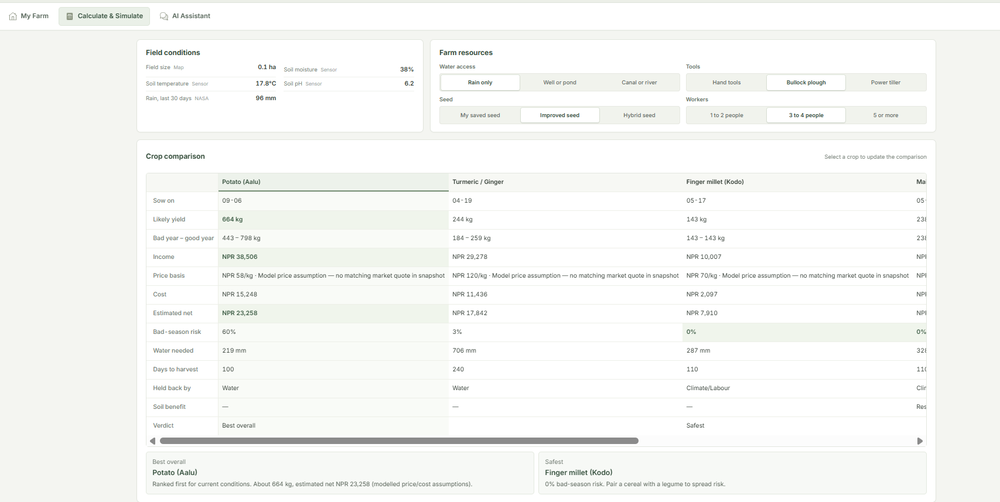
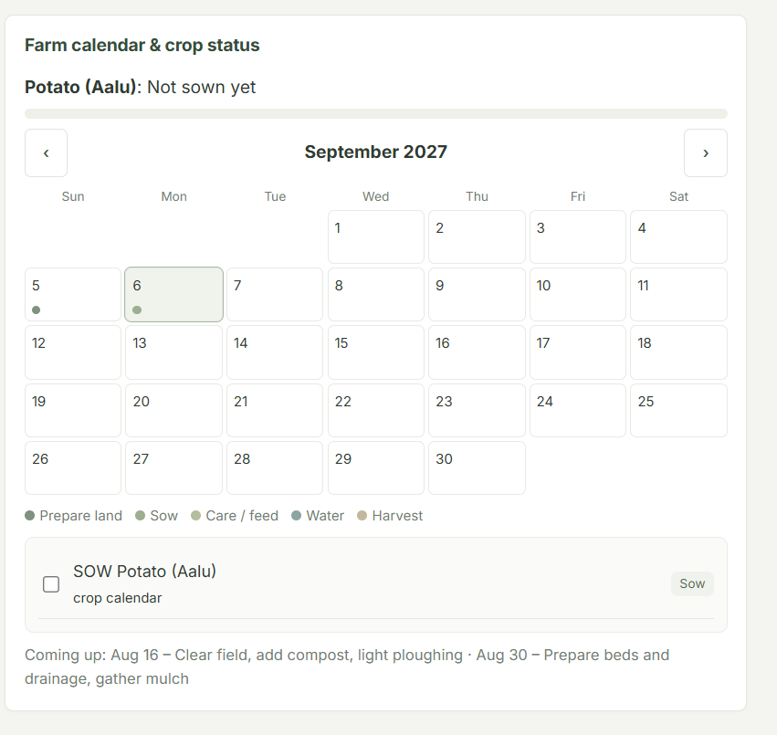
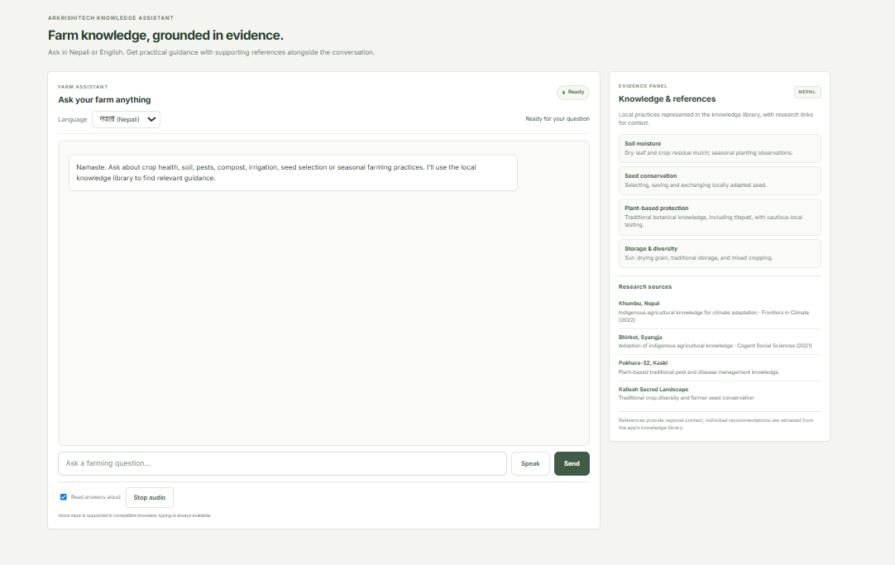
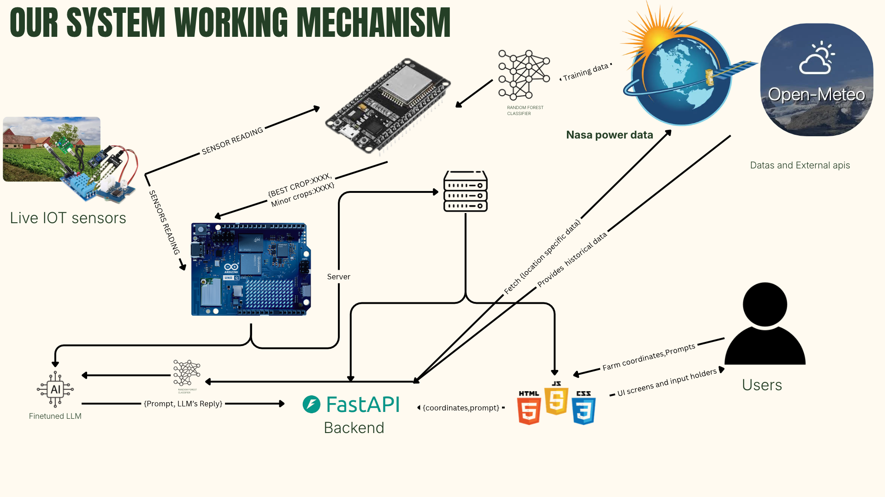

 <div align="center">


# Arkrishitech

### Intelligence for a Changing Agriculture.

**Connecting climate science, agricultural knowledge and field technology to help farmers make better decisions.**

<p>
  <a href="https://arckrishitech.vercel.app/"><strong>EXPLORE LIVE APPLICATION ↗</strong></a>
  &nbsp;&nbsp;·&nbsp;&nbsp;
  <a href="https://github.com/lineo01/Arkrishitech"><strong>VIEW SOURCE CODE</strong></a>
</p>

<br>

<a href="https://arckrishitech.vercel.app/">
  
</a>

<sub>One connected platform for farm mapping, climate information, crop intelligence and field monitoring.</sub>

<br><br>

| Climate Intelligence | Crop Simulation | Agricultural Knowledge | Field Monitoring |
|:---:|:---:|:---:|:---:|
| Historical weather analysis | Data-driven crop comparison | Traditional and research-based knowledge | Connected field observations |

</div>

---

## Agriculture deserves better information.

A farmer deciding what to plant is making more than a choice about seeds.

They are making a decision about an entire growing season — one influenced by rainfall, temperature, soil conditions, water availability, crop characteristics, labour, costs and knowledge passed down through generations.

But what if farmers could explore these factors together before making that decision?

What if they could look back at years of weather records, simulate how different crops might perform, compare potential returns, understand upcoming weather risks and access documented agricultural knowledge — all through one platform?

**That is the idea behind Arkrishitech.**

Arkrishitech is a climate-aware agricultural decision-support platform that brings together historical climate analysis, crop-growth simulation, field monitoring, agricultural research and traditional farming knowledge.

It helps farmers explore possibilities, understand risks and make more informed cultivation decisions.

It is not simply a weather application, a crop calculator or another AI chatbot. It is an attempt to connect the different pieces of information that influence agricultural decisions into one practical system.

The platform currently incorporates Nepal-focused agricultural research and crop information, while its broader architecture and vision are intended to accommodate different geographical regions, climates, crops and farming systems.

---

## A closer look at the platform

The application is designed around the actual decisions farmers make throughout a growing season.

<table>
<tr>
<td width="50%" valign="top">

### 01 — Understand your farm


Map a field, examine its geographical context and bring together available weather information, environmental conditions and sensor readings.

</td>
<td width="50%" valign="top">

### 02 — Discover suitable crops



Explore crop options evaluated against historical climate conditions, crop requirements, planting periods and simulated performance.

</td>
</tr>
<tr>
<td width="50%" valign="top">

### 03 — Compare farming decisions



Change farming inputs and examine how alternative resources and management practices may influence estimated yield and financial outcomes.

</td>
<td width="50%" valign="top">

### 04 — Organise the growing season



Turn a crop decision into a practical cultivation schedule with dated activities and reminders.

</td>
</tr>
<tr>
<td width="50%" valign="top">

### 05 — Explore agricultural knowledge



Access a searchable collection of traditional agricultural practices, research findings and documented knowledge.

</td>
<td width="50%" valign="top">

### 06 — Connect intelligence with the field



Explore the system architecture connecting distributed sensor nodes, computing hardware, agricultural analysis and the web application.

</td>
</tr>
</table>

---

## How farmers use Arkrishitech

### 1. Set up the farm

The farmer selects their farm location and marks the field boundary using an interactive map.

This establishes the geographical context for climate information and crop suitability analysis.

### 2. Understand field conditions

The farmer examines available weather information, historical climate patterns, field conditions, sensor readings and environmental alerts.

The intended connected hardware system will collect measurements from different parts of the farm, helping farmers understand variations in soil and environmental conditions.

### 3. Discover suitable crops

The farmer explores crop recommendations based on historical climate conditions, planting periods and simulated crop performance.

Rather than relying on a generic crop list, the system evaluates candidate crops against the conditions associated with the selected location.

### 4. Compare farming options

The Calculate & Simulate section helps farmers evaluate different crop choices and available resources.

These include:

- Water availability.
- Seeds and seed types.
- Agricultural tools and equipment.
- Available workers and labour.
- Different cultivation practices.

Farmers can change these inputs and compare how different conditions affect simulated outcomes.

### 5. Plan the growing season

The farmer can use the cultivation calendar to understand crop-related activities and organise seasonal work.

Weather information and alerts provide additional context when planning farming operations.

### 6. Access agricultural guidance

The Elder assistant provides access to a searchable agricultural knowledge library containing documented research and traditional farming practices.

---

## What farmers get

| Output | How it helps |
|---|---|
| Crop recommendations | Identify crops worth considering for a location and planting period. |
| Crop suitability estimates | Understand how historical climate conditions relate to crop requirements. |
| Simulated yield | Compare estimated crop performance under different conditions. |
| Economic estimates | Examine estimated costs, returns and profitability. |
| Crop comparisons | Evaluate alternative planting choices. |
| Weather information and alerts | Understand environmental conditions that may affect farm activities. |
| Cultivation calendar | Organise seasonal farming activities. |
| Agricultural knowledge | Access documented research and traditional farming practices. |

All crop and economic outputs are model-based estimates. They support decision-making; they do not guarantee actual harvests or profits.

---

## The intelligence behind the recommendations

Arkrishitech uses historical weather information and agricultural calculations to estimate how different crops may perform under different growing conditions.

### Climate data

**NASA POWER — Historical climate information**

Provides historical daily climate information, covering approximately 30 years where available. The engine uses variables such as:

- Maximum and minimum temperature.
- Precipitation.
- Relative humidity.
- Wind speed.
- Solar radiation.

**Open-Meteo — Weather forecasts**

Provides short-term weather forecasts for the application's weather information and environmental risk checks.

### Agricultural calculations

| Method | Purpose |
|---|---|
| FAO-56 Penman–Monteith | Estimates reference evapotranspiration (ET₀). |
| Crop coefficient (Kc) | Estimates crop water requirements at different growth stages. |
| FAO-33 yield response | Estimates the impact of water stress on potential yield. |
| Soil-water balance | Tracks water availability and crop-water stress. |

The basic crop-water relationship is:

\[
ET_c = K_c \times ET_0
\]

Where:

- \(ET_c\) is crop evapotranspiration.
- \(K_c\) is the crop coefficient.
- \(ET_0\) is reference evapotranspiration.

### How crop ranking works

1. The system obtains historical climate information for the selected location.
2. Candidate crops and their permitted planting periods are identified.
3. Different candidate sowing dates are evaluated.
4. The engine replays crop-water and environmental conditions using historical weather data.
5. Water stress and other modelled risks are evaluated.
6. Simulated crop performance and economic estimates are calculated.
7. Options are ranked using risk-adjusted economic performance.

The historical replay requires a minimum of eight complete historical runs for an evaluation. This is a minimum sample requirement, not a requirement that eight seasons must have been successful.

**Important:** This is a simplified agricultural simulation informed by FAO methodologies. It is not a complete official FAO crop-growth model, and its estimated yields are not measured historical farm yields.

---

## Forecast verification

Historical suitability and upcoming weather are different questions.

A crop may have performed well across historical growing seasons, but the weather expected in the coming weeks may introduce additional risks.

Arkrishitech uses Open-Meteo forecasts to examine available weather conditions around candidate sowing dates.

The additional checks can help identify:

- Heavy rainfall.
- Dry conditions.
- High evapotranspiration.
- Excessive heat.
- Cold conditions.

When an alternative date is available within the forecast period and the crop's permitted sowing months, the application can suggest a lower-risk nearby date.

Dates outside the available forecast window are labelled unverified.

Forecast verification is an additional advisory layer. It does not silently rewrite the historical crop-yield or profitability ranking.

---

## Indigenous knowledge meets agricultural technology

Agricultural knowledge is not limited to modern datasets and scientific calculations.

Farmers and communities have developed practices for seed conservation, mixed cropping, soil management, storage, pest management and adapting to local environmental conditions.

Arkrishitech includes a knowledge assistant called **Elder**, designed to make documented agricultural knowledge easier to discover and explore.

The current implementation uses a searchable knowledge library rather than a fine-tuned or generative large language model.

The library includes research and documented practices concerning:

- Traditional seed selection and preservation.
- Soil fertility and soil management.
- Composting and organic farming practices.
- Traditional pest and disease management.
- Irrigation and water conservation.
- Local agricultural practices and crop management.

### Research sources

| Research | Location / focus |
|---|---|
| Indigenous agricultural knowledge for climate adaptation (2022) | Khumbu, Nepal |
| Adoption of indigenous agricultural knowledge (2021) | Bhirkot, Syangja |
| Traditional plant-based pest and disease management (2023) | Pokhara-32, Kaski |
| Traditional crop diversity and farmer seed conservation (2017) | Kailash Sacred Landscape |
| Traditional crop seed systems (2020) | Nepal |

**Research references**

- [Khumbu — Frontiers in Climate (2022)](https://doi.org/10.3389/fclim.2022.1067630)
- [Bhirkot — Cogent Social Sciences (2021)](https://doi.org/10.1080/23311932.2021.1914384)
- [Pokhara-32 — HEBIDS (2023)](https://doi.org/10.3126/hebids.V9i1.59586)
- [Kailash Sacred Landscape — Agroecology and Environment](https://www.nepjol.info/index.php/AEJ/article/view/19886/16374)
- [Traditional Crop Seed Systems (2020)](https://giwmscdnone.gov.np/media/app/public/75/posts/1685027773_12.pdf)

These publications contribute to the knowledge component; they are not treated as direct crop-yield training datasets.

Practices are kept associated with their documented sources and geographical context. A practice documented in one region should not automatically be assumed to apply everywhere.

---

## Beyond the web application: Connected field intelligence

The long-term hardware system is designed around distributed field monitoring and a central computing hub.

### ESP sensor nodes

Multiple ESP-based devices are intended to be distributed across a farm.

Each node can collect measurements from its own field location, potentially including:

- Soil moisture.
- Soil temperature.
- Air temperature.
- Other environmental measurements.

This distributed approach is intended to provide a better picture of field conditions than relying on a single sensor location.

### Arduino UNO Q — Central hub

The Arduino UNO Q is planned as the main hardware hub, coordinating the ESP nodes and processing incoming field information.

It contains two computing components:

| Component | Intended responsibility |
|---|---|
| STM32U585 | Sensor interfacing, hardware coordination and real-time control. |
| Qualcomm QRB2210 | Debian Linux applications, higher-level processing and local AI inference. |

The Linux processor is the intended environment for the local Indigenous Knowledge AI, while the microcontroller handles hardware-level tasks.

### Intended system architecture

```text
                     FARM
                       |
              +--------+--------+
              |        |        |
           ESP Node ESP Node ESP Node
              |        |        |
              +--------+--------+
                       |
                       v
                ARDUINO UNO Q
                  CENTRAL HUB
                       |
              +--------+--------+
              |                 |
           STM32U585         QRB2210
         Sensor Control   Linux Processing
                                |
                     Indigenous Knowledge AI
                        (Planned Local AI)
                                |
                       Data Synchronization
                                |
                                v
                         FASTAPI BACKEND
                                |
              +----------------+----------------+
              |                |                |
          Crop Engine      Climate Data    Knowledge Base
              |                |                |
              +----------------+----------------+
                                |
                                v
                         WEB APPLICATION
                                |
                    Farm Dashboard and Insights
```

The final objective is to connect field measurements, local agricultural intelligence, climate analysis and the web application into one integrated farming-support system.

---

## The future of agricultural intelligence

The long-term vision is to develop an agricultural knowledge system that can provide locally relevant guidance using documented research and traditional farming knowledge.

Planned development includes:

1. Collecting agricultural research and documented traditional knowledge.
2. Extracting and organising agricultural information.
3. Preserving references, locations and source attribution.
4. Preparing structured training datasets.
5. Fine-tuning a suitable language model.
6. Optimising the model for edge deployment.
7. Deploying a compact model on the Arduino UNO Q.

The aim is to make agricultural knowledge accessible even when farmers do not have continuous access to cloud-based AI services.

**Current status:** The backend includes a searchable knowledge library through `kb.py` and `knowledge.json`. The dedicated fine-tuned local model and its deployment on the UNO Q are planned components, not completed features.

---

## Technology stack

| Area | Technology |
|---|---|
| Backend | Python, FastAPI |
| Frontend | Web application |
| Climate data | NASA POWER, Open-Meteo |
| Crop modelling | FAO-56 and FAO-33 methodologies |
| Sensor nodes | ESP-based devices |
| Central hub | Arduino UNO Q |
| Hardware control | STM32U585 |
| Edge computing | Qualcomm QRB2210, Debian Linux |
| Knowledge library | Python, structured agricultural research |
| Local AI | Fine-tuned agricultural model (planned) |

---

## Run locally

### Requirements

- Python 3.10 or later.
- Node.js and npm.
- Git.

### 1. Clone the repository

```bash
git clone https://github.com/lineo01/Arkrishitech.git
cd Arkrishitech
```

### 2. Install backend dependencies

```bash
pip install -r requirements.txt
```

### 3. Start the backend

```bash
uvicorn backend.app.main:app --reload
```

### 4. Start the frontend

Open another terminal:

```bash
cd frontend
npm install
npm run dev
```

For deployment instructions, refer to [`DEPLOYMENT.md`](DEPLOYMENT.md).

---

## Project status

Arkrishitech is under active development.

| Component | Status |
|---|---|
| Web application | Implemented |
| FastAPI backend foundation | Implemented |
| Historical climate integration | Implemented |
| Initial crop recommendation and simulation engine | Implemented |
| Searchable agricultural knowledge library | Implemented |
| ESP distributed sensor network | Planned integration |
| Arduino UNO Q central hub | Planned integration |
| Automated field-data synchronization | Planned integration |
| Fine-tuned Indigenous Knowledge AI | Planned development |
| Local AI deployment on UNO Q | Planned development |

Sensor simulation and device connectivity should not be confused with a fully validated physical sensor network. Hardware calibration, field testing and end-to-end integration remain necessary.

## Limitations and responsible use

- Crop recommendations depend on the accuracy and availability of historical climate data.
- Climate-grid information may differ from conditions measured directly on an individual farm.
- Simulated yields and economic estimates are not guaranteed outcomes.
- Crop parameters and financial assumptions require local validation.
- Sensor measurements require physical hardware integration and proper calibration.
- Indigenous knowledge must be verified and interpreted within its local context.
- The dedicated local AI and complete distributed hardware system are still under development.

---

## Our vision

We believe the future of agriculture should not require choosing between traditional knowledge and modern technology.

Farmers have accumulated generations of experience observing their land, weather, crops and ecosystems. Climate science and digital tools can extend that knowledge with new ways to analyse conditions, compare possibilities and understand risks.

**Arkrishitech aims to bring these worlds together.**

Scientific agricultural modelling. Indigenous knowledge. Real-time field intelligence.

The ambition extends beyond one location or one set of crops: to create adaptable agricultural tools that respect regional differences while making useful information easier to access and understand.

Technology should help farmers understand their choices, not make those choices for them.

---

<div align="center">


### Arkrishitech

**Climate intelligence. Agricultural knowledge. Better farming decisions.**

<br>

<a href="https://arckrishitech.vercel.app/"><strong>EXPLORE THE LIVE APPLICATION ↗</strong></a>

<br><br>

<a href="https://github.com/lineo01/Arkrishitech">Git